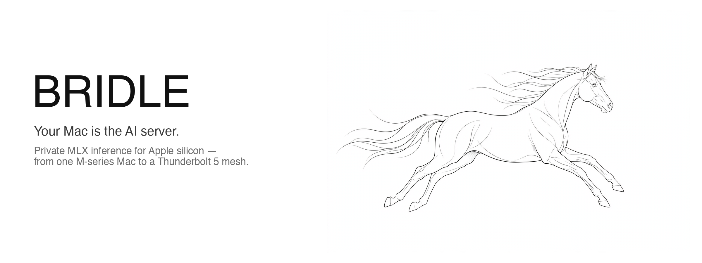
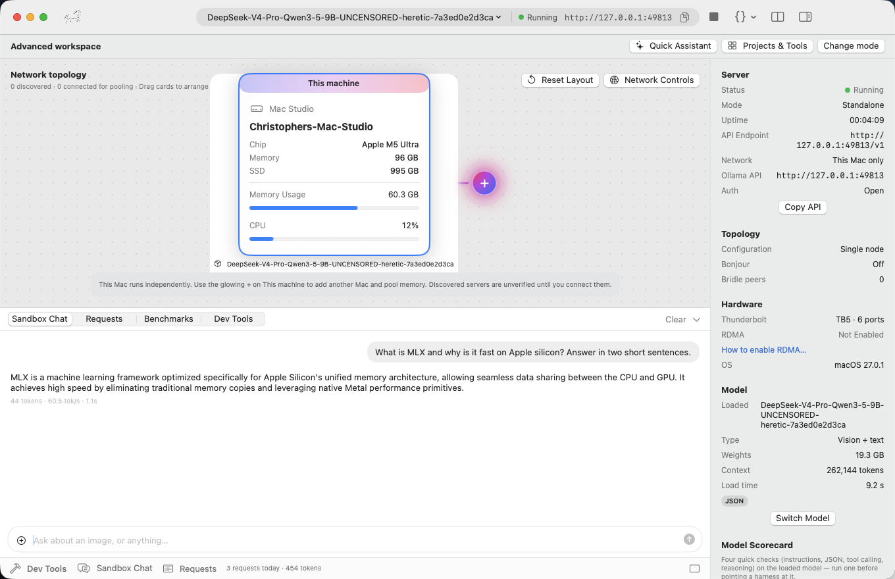
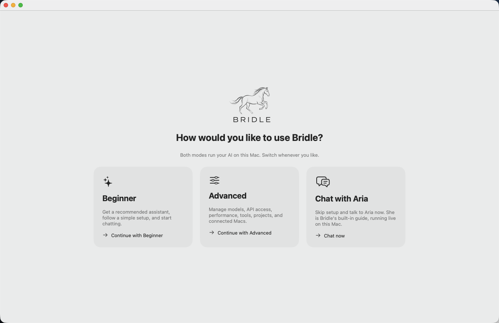
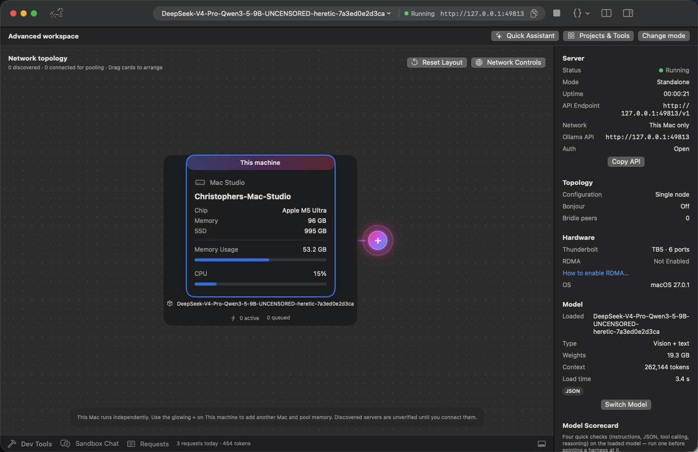
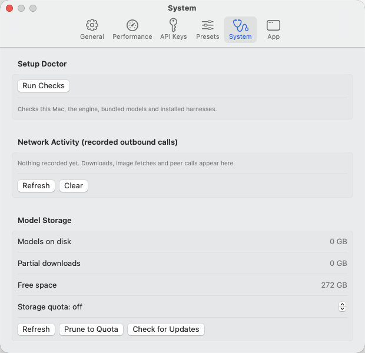
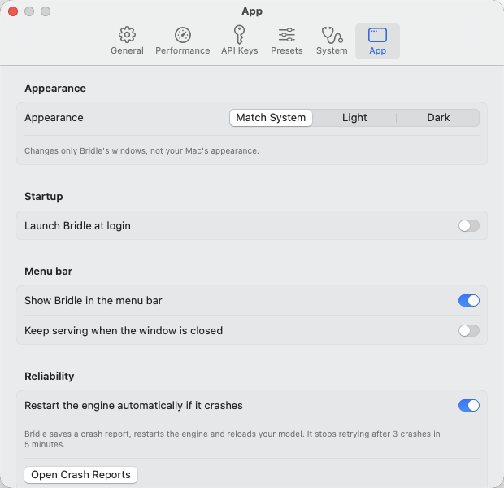

<p align="center"></p>

<p align="center">
  <a href="#getting-started-on-your-mac"><strong>Get started</strong></a> ·
  <a href="#mesh-mode-thunderbolt-5-memory-pooling"><strong>Mesh Mode</strong></a> ·
  <a href="#harnesses"><strong>Harnesses</strong></a> ·
  <a href="docs/HARDWARE.md"><strong>Hardware guide</strong></a> ·
  <a href="FEATURES-30.md"><strong>30-feature guide</strong></a>
</p>

<p align="center">
  
  
  
  
</p>

# Bridle

Bridle turns a Mac into a private AI inference server. It runs open-weight models on Apple silicon with [MLX](https://github.com/ml-explore/mlx) — Apple's own machine-learning framework, built for unified memory. Nothing leaves your hardware, and other apps use it through **OpenAI-, Anthropic-, Responses- and Ollama-compatible APIs**.

Version 0.2 runs on one Mac, or across several Thunderbolt 5 Macs in [Mesh Mode](#mesh-mode-thunderbolt-5-memory-pooling), pooling their unified memory into one model server. Bonjour discovery of other Bridle servers is already in place.

<p align="center"></p>

## Built for MLX, tailored for M-series Macs

Bridle is not a cross-platform port. It is written around how Apple silicon actually works:

- **Unified memory is the VRAM.** MLX's zero-copy design means a 96 GB Mac Studio can serve models that would never fit a 32 GB discrete GPU — and Bridle's memory guard, fit estimates and mesh planner all reason in those terms (GPU wired-memory budget ≈ ⅔–¾ of RAM, not a fixed VRAM size).
- **Tuned for the M5 generation.** On the Mac Studio M5 Ultra (1.2 TB/s unified bandwidth, GPU-integrated Neural Accelerators), prompt ingestion runs roughly 3.5–4× faster than an M3 Ultra, so long harness system prompts and RAG contexts stay interactive. Single-stream generation still follows physics — effective bandwidth ÷ active weight bytes — which is why Bridle leans on speculative decoding, prompt caching (RAM *and* disk) and MoE-friendly fit estimates rather than brute force.
- **Every tier is first-class.** The same build serves an 8B on a base M-series laptop and a 122B MoE on a 96 GB Studio; the model browser tells you which before you download. See the [hardware guide](docs/HARDWARE.md) for measured token rates by model and memory tier, plus honest comparisons against dual-RTX-5090 workstations (faster under 64 GB, irrelevant above it).

| This machine (screenshot above) | |
|---|---|
| Mac Studio, Apple M5 Ultra, 96 GB unified memory | 19.3 GB vision+text model loaded in 9.2 s |
| Local chat | 60.5 tok/s generation, zero network |
| Mesh-ready | Thunderbolt 5 × 6 ports, RDMA-capable |

## Beginner and Advanced modes

Choose your experience at startup. **Beginner** guides setup, recommends an assistant and opens chat. **Advanced** opens the machine canvas and model controls. Both can open **Projects & Tools** for documents, workspaces, jobs, workflows, evaluations and operational controls. **Change mode** returns to the chooser.

Quick Assistant: **Control–Option–Space**. The Assistant menu provides the same entry point. Voice and screenshots are explicitly initiated there. **Ask Aria** (in Beginner home and Quick Assistant) opens Aria, the built-in guide powered by a bundled 0.6B reasoning model (Qwen3, 4-bit; Bridle strips its thinking tags) that runs in her own slot next to your assistant: she explains Bridle from a bundled guide plus live app state, and may suggest a download, load, or screen to open — each runs only when you tap Approve.

**Remote workspaces (Projects & Tools → Remote Connections):** connect to another Mac or Linux host over SSH (agent or key-file reference; host keys are verified and trusted explicitly for Bridle only), browse its folders, and bind a folder to a task as its workspace. Tasks show where they run and where the model runs; the model always runs on this Mac, and choosing a folder never downloads it. Bounded reads and preview-approved writes/transfers are available per workspace.

See [the 30-feature guide](FEATURES-30.md) for entry points, permissions and MVP limitations.

## Screenshots

| | |
|---|---|
|  |  |
| *Start in Beginner, Advanced, or straight into chat with Aria* | *The machine canvas at night — same live stats, Dark Mode throughout* |
|  |  |
| *Settings → System: Setup Doctor, recorded outbound calls, model storage* | *Appearance, login item, menu bar and crash recovery* |

## Features

**Core:** a canvas card for this Mac (chip, memory, live CPU and memory use, Thunderbolt and RDMA status), a model browser with a fit estimate for this Mac, resumable downloads with SHA-256 verification for files carrying Hub LFS hashes, an OpenAI-compatible server, a sandbox chat, an inspector, dev tools, and terminal commands for every job.

**Production add-ons**

| # | Feature | What it does |
|---|---|---|
| 1 | **Speculative decoding** | Pair a model with a small draft model of the same family, e.g. Qwen3 14B with Qwen3 0.6B. The draft guesses ahead and the big model checks its guesses. Output is the same, usually faster. |
| 2 | **Prompt caching** | Keeps the work already done on the previous turn's prompt, so follow-up turns only process new tokens. Responses report the reused count in `usage.prompt_tokens_details.cached_tokens`. |
| 3 | **Continuous batching** | Concurrent requests are generated together (mlx-lm `BatchGenerator`), and requests that arrive mid-batch join it. |
| 4 | **Memory guard** | Before loading, checks the model against free memory and the GPU budget. If it won't fit, you get a warning with "Load anyway" instead of heavy swapping. |
| 5 | **Idle unload** | Frees memory after N idle minutes. The model reloads automatically on the next request. |
| 6 | **Tool calling** | OpenAI `tools`/`tool_calls` (and `tool_choice`) using each model's own format. Covers mlx-lm's parsers for Qwen, Mistral, Gemma, GLM, Kimi and others, with recovery for small models that write slightly broken JSON. |
| 7 | **Guaranteed JSON** | `response_format: json_object / json_schema`, enforced with grammar-constrained decoding ([llguidance](https://github.com/guidance-ai/llguidance)). The output always parses and matches the schema, unless `max_tokens` cuts it off. |
| 8 | **Embeddings** | `/v1/embeddings` (float or base64) with MiniLM, BGE, Qwen3-Embedding and others. |
| 9 | **Vision** | Image inputs (`image_url`, data or http URLs) for Qwen2.5-VL, Gemma 3 and SmolVLM. The chat has attach and drag-and-drop. |
| 10 | **Speech to text** | `/v1/audio/transcriptions` with Whisper (json, text, srt, vtt, verbose_json). The chat has a "Transcribe audio" button. No ffmpeg needed. |
| 11 | **Ollama API** | `/api/chat`, `/api/generate`, `/api/tags`, `/api/ps`, `/api/show`, `/api/embed`, `/api/pull`, `/api/delete`, `/api/version`, all streaming NDJSON. |
| 12 | **Named API keys** | One key per app or device, each with optional requests-per-minute and tokens-per-day limits. Only a hash is stored, and keys can be revoked. Inference requests from this Mac are exempt by default — that means any program running on this Mac (any user account) can use inference without a key unless you turn on "require a key on this Mac". Model pull/delete via the Ollama API always require a key or the control token. |
| 13 | **HTTPS + Bonjour** | HTTPS for network inference with an auto-renewed self-signed certificate (the SHA-256 fingerprint shows in the inspector). Advertises `_bridle._tcp` and lists other Bridle servers on the network. |
| 14 | **Request history** | Every request in SQLite: client, model, tokens, cached tokens, tok/s, status. Prompt and response text are stored only if you turn that on. |
| 15 | **Menu bar mode** | A menu bar icon with status, model switching and copy-URL. Bridle can keep serving with the window closed and can launch at login. |
| 16 | **Benchmarks** | Prompt and generation speed, time to first token and peak memory per model (and draft pairing). Results are saved. |
| 17 | **Compare** | One prompt through 2–4 models side by side, loaded one at a time so it only needs the largest model's memory. Your current model is restored afterwards. |
| 18 | **Presets** | Named model, system prompt and defaults. Any client uses one with `model: "preset:Coder"`, and values a client sends explicitly win. |
| 19 | **Signed builds + auto-update** | Sparkle updates. `scripts/release.sh` signs with Developer ID, notarizes, staples and writes the appcast. |
| 20 | **Crash recovery** | If the engine dies, Bridle writes a crash report (logs plus a native faulthandler trace), restarts it and reloads your model. It gives up after 3 crashes in 5 minutes. |

Two more fixes made along the way: a client that disconnects now cancels its generation (logged as status 499), and the engine exits if the app goes away.

## Mesh Mode (Thunderbolt 5 memory pooling)

> **One model. Several Macs. One pool of memory.**
> Two 96 GB Mac Studios become a ~160 GB usable pool; four become a frontier-MoE server — silent, under 310 W each, no rack, no cloud. This is the workload unified memory was made for, and the one a discrete-GPU workstation structurally cannot do: its VRAM stops at the card.

Mesh Mode runs one model across several Macs connected by Thunderbolt 5. Their unified memory is pooled, so you can run models no single Mac can hold. It uses RDMA over Thunderbolt (macOS 26.2+, Apple TN3205) through MLX's JACCL backend: data moves between Macs in under 50 µs, versus about 300 µs over TCP.

```
 Mac Studio A (coordinator, serves /v1)          Mac Studio B
 ┌──────────────────────────────┐   Thunderbolt 5 RDMA   ┌──────────────────────────────┐
 │ MLX rank 0 · shard of weights │◄──────────────────────►│ MLX rank 1 · shard of weights │
 │ tensor/pipeline split by plan │      < 50 µs / hop     │ control via pinned HTTPS     │
 └──────────────────────────────┘                        └──────────────────────────────┘
        ▲  clients see one model:  "mesh"  (or its repo id) in /v1/models
```

What Bridle does for you: reads the cabling, builds the RDMA device matrix, checks every Mac (macOS, Thunderbolt generation, ports, free memory, model revision) with a per-item fix list, downloads the model where it's missing, starts each Mac's rank over the existing pinned-certificate peer channel, and serves the pooled model from the coordinator's normal API. Tensor parallelism on a full mesh, pipeline on a ring or TCP fallback.

**Requirements:** macOS 26.2 or later and Thunderbolt 5 on every Mac (M4 Pro/Max or later Pro/Max chips, M3 Ultra or later Ultras). Base M4 Mac minis have Thunderbolt 4 and can't use RDMA. You also need direct Thunderbolt 5 cables between the Macs. One cable is enough for two Macs. For three or four, connect every pair (full mesh). For five or more, connect them in a ring. A second cable between a pair adds bandwidth. Links are point-to-point and there are no Thunderbolt 5 switches, so a full mesh of N Macs needs N−1 ports on every Mac. A 6-port M5 Ultra Mac Studio tops out at 7 in a full mesh. 2–4 Macs is the recommended, best-tested size. The planner checks your port counts and suggests a ring when a full mesh won't fit.

**Enable RDMA once on every Mac.** This can only be done at the Mac, from macOS Recovery:
1. Shut down the Mac, then press and hold the power button until the startup options appear.
2. Choose **Options**, then **Continue**.
3. From the menu bar choose **Utilities > Terminal** and run `rdma_ctl enable`.
4. Restart into macOS. Check with `ibv_devices`. Once the cables are connected, `ibv_devinfo` should show the `rdma_en*` ports as `PORT_ACTIVE`.

Then turn off the Thunderbolt Bridge on each Mac (System Settings > Network > Thunderbolt Bridge > Inactivate).

**Running a mesh.** Open **Models > Mesh Mode…** (or Studio > Mesh) on the Mac you use. That Mac is the coordinator (rank 0) and serves the pooled model.
1. On each other Mac, pair this Mac under Network with **Allow mesh** turned on. Then approve that Mac here as a peer, using its HTTPS endpoint, key and certificate.
2. Select the Macs and choose a model. **Check** shows what each Mac is missing, with the fix for each item. **Download on all Macs** fetches the model where it's missing.
3. **Start Mesh**. Every Mac joins the MLX group and loads only its share of the weights.

The model then appears in `/v1/models` with kind `mesh`. Call it by its id, or as `"mesh"`, like any other model.

How it works:
- **Wiring.** Bridle reads the cabling the same way `mlx.distributed_config` does (`system_profiler SPThunderboltDataType` plus `networksetup`), builds the RDMA device matrix, and starts each Mac's rank with the environment `mlx.launch` would set (`MLX_RANK`, `MLX_JACCL_COORDINATOR`, `MLX_IBV_DEVICES`).
- **Serving.** Each rank runs `mlx_lm.server` in distributed mode.
- **Split.** Tensor parallelism is the default on a full mesh. Pipeline parallelism is used for a ring or a TCP mesh.
- **Control channel.** The Macs coordinate over the existing pinned-certificate HTTPS peer channel. The member API (`/mesh/*`) requires a key with the mesh grant. Tensors travel only over RDMA, or over TCP when you explicitly allow the slower TCP fallback.

Limits:
- Mesh over RDMA has not yet been validated on real multi-Mac Thunderbolt 5 hardware; automated tests cover the TCP-ring path on one Mac (see ROADMAP).
- A key with the mesh grant is powerful: its holder can start/stop this Mac's mesh rank, trigger model downloads and hold this Mac's memory. Only grant it to Macs you control.
- While a mesh runs, nothing else loads on those Macs.
- Draft models and adapters aren't available on a mesh.
- The Ollama-compatible `/api` routes don't serve the pooled model.
- Every Mac stores the full model, though each loads only its share into memory.

## Architecture

```
┌──────────── Bridle.app (SwiftUI, macOS 14+) ─────────────┐
│ UI ─▶ AppModel (@Observable) ─▶ EngineClient (HTTP)       │
│   menu bar · settings · compare · requests · benchmarks   │
│ EngineProcess (spawn, crash recovery) · Sparkle · SMApp   │
└──────────────────────────────┬────────────────────────────┘
           per-launch control token, loopback only
┌──────────────────────────────▼────────────────────────────┐
│ bridle_engine (Python, FastAPI + uvicorn [+ TLS server])   │
│  api.py      /v1 (OpenAI) · /control (app) · ASGI auth     │
│  ollama.py   /api (Ollama)                                 │
│  service.py  presets · history recorder · async bridge     │
│  runtime.py  one MLX thread: single path (cache, draft,    │
│              grammar, vision) + continuous batching        │
│  textproc    stop sequences · <think> · tool-call routing  │
│  structured  llguidance JSON-schema masks                  │
│  keys · history (SQLite) · presets · settings · jobs       │
│  discovery (zeroconf) · tls (self-signed) · downloads      │
│  embeddings · audio · vision  (optional extras)            │
└────────────────────────────────────────────────────────────┘
```

Data lives in `~/Library/Application Support/com.bridle.app/`: `models/`, `settings.json`, `api_keys.json` (hashes only), `presets.json`, `requests.sqlite3`, `benchmarks.json`, `tls/`, `crash/` and `CrashReports/`.

## Getting started (on your Mac)

You need Xcode 15+ (or the Swift 5.9+ command line tools), Python 3.11+ (`brew install python@3.12`), and an Apple silicon Mac.

```bash
scripts/setup_engine.sh --extras   # engine + vision/embeddings/speech (or click "Set Up Engine" in the app)
scripts/smoke_test.sh              # end-to-end check with a 0.3 GB model
cd app && swift run                # run from source (or open app/Package.swift in Xcode and press ⌘R)
scripts/build_app.sh               # double-clickable dist/Bridle.app
```

Without `--extras`, the app offers an **Install** button the first time you open the Vision, Embeddings or Speech tab of the model browser.

## Using the APIs

```python
from openai import OpenAI
client = OpenAI(base_url="http://127.0.0.1:49813/v1", api_key="brdl_…")   # key only needed off this Mac

client.chat.completions.create(model="preset:Coder", messages=[...])                 # presets
client.chat.completions.create(model="mlx-community/Qwen3-8B-4bit", messages=[...],
    tools=[...])                                                                       # tool calling
client.chat.completions.create(..., response_format={"type": "json_schema",
    "json_schema": {"name": "x", "schema": {...}}})                                    # guaranteed JSON
client.embeddings.create(model="mlx-community/all-MiniLM-L6-v2-bf16", input=["a", "b"])
client.audio.transcriptions.create(model="mlx-community/whisper-small-asr-fp16", file=open("a.m4a", "rb"))
```

Ollama clients: point them at `http://<mac>:49813`, the same port, and use the Hugging Face id as the model name.

## Harnesses

Load a model, then pick one in the **Harness** toolbar menu. Selecting writes that harness's wiring files (a launch `.command` + README, regenerated when the model or port changes) under `~/Library/Application Support/com.bridle.app/harness/` — Bridle never edits the harness's own global config. **Launch** opens the harness through those files:

- **Claude Code:** Bridle serves the Anthropic Messages API (`POST /v1/messages`, streaming, tool use, `count_tokens`; `x-api-key` or bearer auth). Launch opens `claude` with `ANTHROPIC_BASE_URL=http://127.0.0.1:<port>` and the loaded model as `ANTHROPIC_MODEL`. Names starting `claude-` map to the loaded model.
- **Deepseek harness (`dsh`):** Launch runs `dshctl add-model --id bridle --base-url http://127.0.0.1:<port>/v1 --model <loaded>` against your running `dsh web`, registering Bridle as a provider (your other providers are untouched). Pick "Bridle (this Mac)" in the model picker.
- **Lemonade:** Launch runs `lemonade cloud install bridle --base-url http://127.0.0.1:<port>/v1`, registering Bridle as a provider in your Lemonade server (undo: `lemonade cloud uninstall bridle`).

Kiro and Antigravity are not listed: neither accepts a custom model endpoint through any supported route (Kiro is AWS-hosted-only; Antigravity's IDE/CLI serve Google's model list — only its Python SDK takes OpenAI-compatible servers).

## Production operations

Settings → **System** holds the **Setup Doctor** (this Mac, engine, extras, harnesses — with the fix for each failure), the **network-activity log** (the engine's recorded outbound calls: downloads, image fetches, peer/MCP, mesh), **model storage** (usage, quota + prune, hash re-verify and revision update checks), **support bundles** and **encrypted backup/restore**. The Inspector's **Model Scorecard** runs four behavioural checks (instructions, JSON, tool calling, reasoning) and flags whether the loaded model is harness-ready. Prometheus metrics are at `GET /metrics` (this Mac only). Performance settings add an on-disk prompt cache, an optional second resident **fast model**, a request queue (concurrency + wait instead of instant 429s), and a remote-image kill switch. `scripts/release.sh --check` reports what a signed release still needs on this Mac.

**Browser protection.** Web pages can't call the API: a request carrying a foreign `Origin` header, or a request from this Mac whose `Host` isn't `127.0.0.1`/`localhost`/`[::1]` (DNS rebinding), is refused with 403. Normal clients (SDKs, curl, editors) are unaffected. To let a specific browser UI call Bridle directly, start the engine with `BRIDLE_ALLOWED_ORIGINS=https://ui.example,http://localhost:3000` (same-machine `localhost` origins are already allowed).

## Terminal (works without the app)

```bash
scripts/bridle models | download <repo> | chat <repo> [--draft <repo>] | bench <repo>
scripts/bridle embed <repo> "text" | transcribe <repo> audio.wav --format srt
scripts/bridle keys create "Gio's laptop" --rpm 60 --daily-tokens 200000
scripts/bridle presets set Coder --model mlx-community/Qwen3-8B-4bit --system "You write code." --temperature 0.2
scripts/bridle requests | settings batching=false idle_unload_minutes=15 | extras all
scripts/bridle serve --host 0.0.0.0
```

## Releasing

`scripts/release.sh` signs with your Developer ID (hardened runtime), notarizes and staples the app, then writes the Sparkle `appcast.xml`. The one-time setup is described at the top of the script.

## Tests

```bash
cd engine && PYTHONPATH=. python -m pytest   # the first run auto-fetches the fixture models (~400 MB, cached under ~/Library/Caches/com.bridle.app/test-models)
scripts/fetch_test_models.sh                 # fetch/refresh the fixture models yourself; BRIDLE_TEST_MODELS_DIR overrides the cache location   # unit/API tests; real-model end-to-end tests skip without the fixture models
cd app && swift test                                                # decoding/SSE tests on live-captured fixtures (requires full Xcode)
```

## Status of this build

* **Engine:** every feature was run against real models on Linux CPU (MLX 0.32, mlx-lm 0.32), so speeds here don't reflect a Mac. Tested models: Qwen2.5 0.5B and Qwen3 0.6B (text, tools, reasoning, speculative decoding), SmolVLM 256M (vision), MiniLM (embeddings) and Whisper tiny (speech). HTTPS, Bonjour advertising and cancel-on-disconnect were tested against a live server.
* **App:** the non-UI Swift (domain, client, process, AppModel) type-checks and its unit tests pass against fixtures captured from the live engine. All views parse. The bundled `dist/Bridle.app` is an ad-hoc signed development build (Gatekeeper will reject it); a distributable build needs the Developer ID signing and notarization flow in `scripts/release.sh`, rehearsed on a machine with full Xcode.


### Network and request limits

Remote inference requires HTTPS; plaintext remote `/v1` and `/api` requests return 426. Enable HTTPS in Settings, restart the engine, and pin the certificate fingerprint shown in the inspector. The desktop control connection stays on loopback. The copied API endpoint prefers HTTPS when sharing and TLS are active.

JSON requests are limited to 2 MiB before parsing. At most 16 inference requests are admitted at once, including streaming requests; additional requests return 429. Management and health checks remain available during inference overload. Ollama model pull and delete are management operations: they are only available from this Mac, not to remote API-key holders, and they require an API key or the control token (manage models in the app, or send `Authorization: Bearer <key>`). JSON request bodies must carry `Content-Type: application/json` (SDKs already do; add `-H 'Content-Type: application/json'` to bare curl calls). Remote image URLs for vision models must resolve to public addresses.

Partial downloads now live under `models/.partials/<owner>/<name>` to avoid collisions with valid model names ending in `.partial`. Existing completed models keep their paths. Old sibling partial folders are left untouched; a new retry uses the new location. Downloads track their revision, and unhashed config/tokenizer files are fetched again instead of trusting an old file of the same length.


### Use models you already downloaded

Choose **Models → Import Models from My Mac** or **Beginner → Use My Models**. Select your AI folder (a single model, a collection, or a Hugging Face cache), scan it, and choose **Add & Host Selected Model**. Original files stay in place; removing an imported `local/…` entry only removes its reference. Keep external disks/folders available after importing.

The current engine hosts compatible MLX/Safetensors text and vision models, with speech/embedding models available through their APIs when their support is installed. GGUF, missing tokenizer files, incomplete shards and unsupported architectures are reported rather than silently converted or claimed to work. Hosting one chat model replaces the resident model, subject to the memory check.
