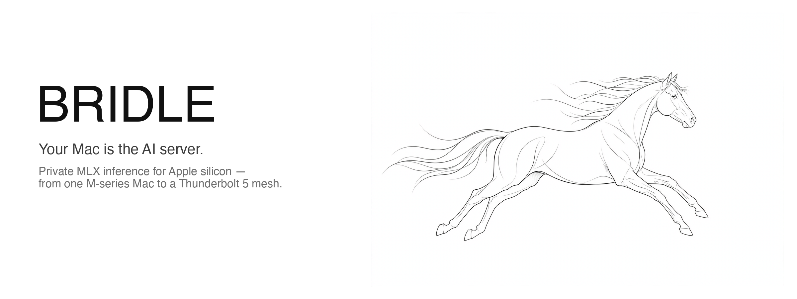
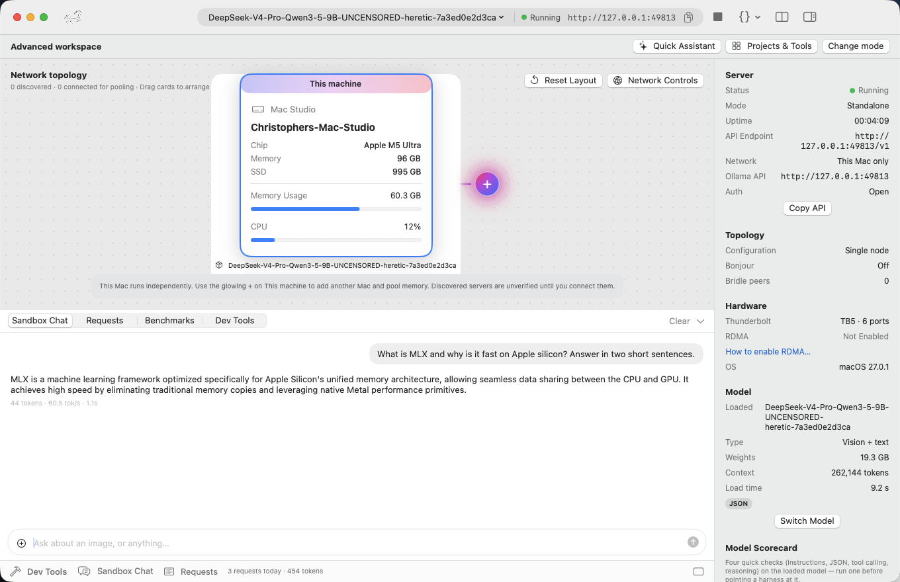
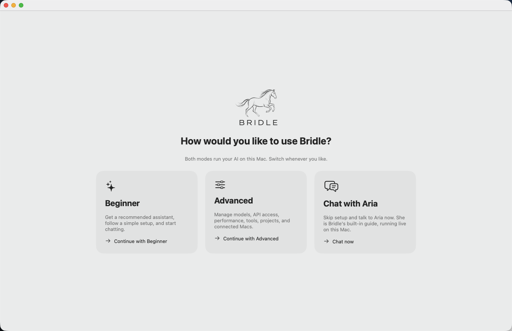
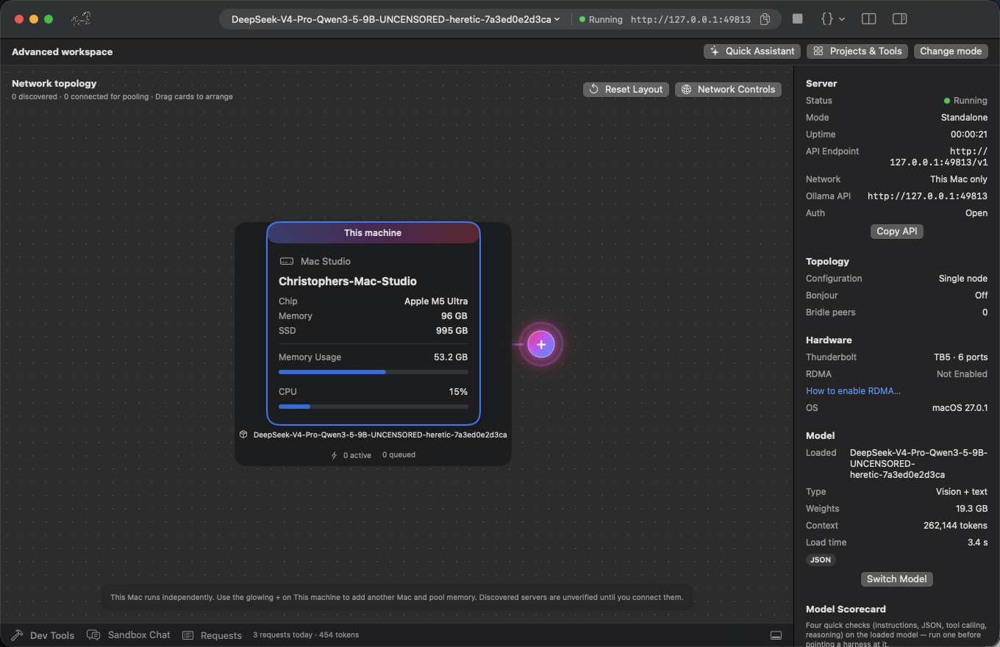
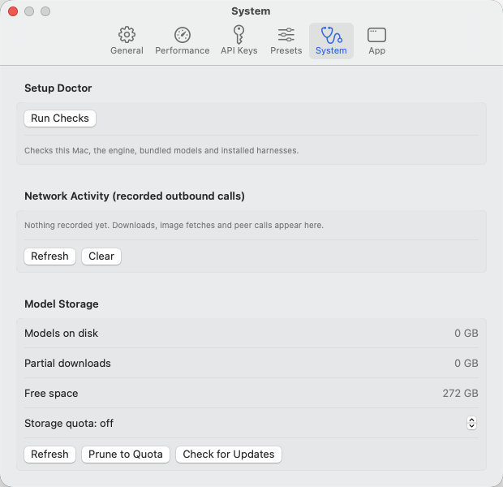
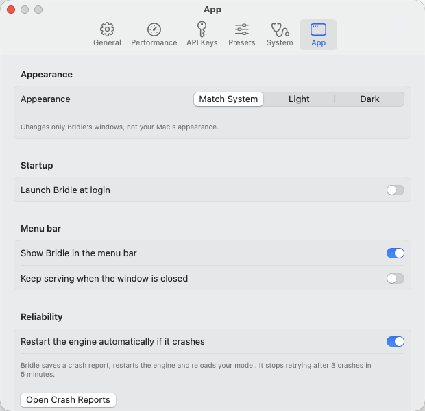

<p align="center"></p>

# Bridle

**Your Mac is the AI server.** Bridle turns an Apple silicon Mac into a private AI inference server built on [MLX](https://github.com/ml-explore/mlx) — Apple's machine-learning framework for unified memory. Open-weight models run entirely on your hardware; nothing leaves the machine. Editors, scripts and agent harnesses connect through **OpenAI-, Anthropic-, Responses- and Ollama-compatible APIs** on one local endpoint.

<p align="center"></p>

## Why Bridle

- **Made for MLX, tailored for M-series Macs** — memory guard and fit estimates reason in unified-memory terms; on an M5 Ultra (1.2 TB/s, GPU Neural Accelerators) prompt ingestion is ~3.5–4× an M3 Ultra, and disk-persisted prompt caching keeps repeat harness prompts instant.
- **Harness-ready out of the box** — pick Claude Code, Codex, OpenCode, DeepSeek Harness or Lemonade in the toolbar and Bridle writes the wiring (Anthropic `ANTHROPIC_BASE_URL`, Responses provider override, `dshctl add-model`, `lemonade cloud install`). Your harnesses drive *your* local model, with its real context window respected.
- **Mesh memory pooling** — several Thunderbolt 5 Macs pool unified memory over RDMA (<50 µs/hop via MLX JACCL) and serve one model no single Mac could hold, planned and checked by Bridle before anything loads.
- **Production-shaped serving** — speculative decoding, continuous batching, a request queue with per-key limits, guaranteed-JSON decoding, embeddings, vision, speech-to-text, named API keys, HTTPS + Bonjour, and crash recovery.
- **Private by construction** — prompt text is logged only if you turn it on; every outbound call the engine makes is listed in the network-activity log; keys are hashes at rest and plaintext only in your Keychain.

## Screenshots

| | |
|---|---|
|  |  |
| *Beginner, Advanced, or straight to Aria* | *The machine canvas in Dark Mode* |
|  |  |
| *Setup Doctor, network activity, storage* | *Appearance, startup, reliability* |

## Mesh Mode: one model, several Macs, one pool of memory

```
 Mac Studio A (coordinator, serves /v1)          Mac Studio B
 ┌──────────────────────────────┐   Thunderbolt 5 RDMA   ┌──────────────────────────────┐
 │ MLX rank 0 · shard of weights │◄──────────────────────►│ MLX rank 1 · shard of weights │
 │ tensor/pipeline split by plan │      < 50 µs / hop     │ control via pinned HTTPS     │
 └──────────────────────────────┘                        └──────────────────────────────┘
        ▲  clients see one model:  "mesh"  in /v1/models
```

Two 96 GB Studios pool to a ~160 GB usable server; four reach frontier-MoE territory — silent, under 310 W each, no rack. Tensor parallelism on a full mesh, pipeline on a ring, TCP only if you explicitly allow it. [Full Mesh guide →](https://github.com/coldrazer/Bridle#mesh-mode-thunderbolt-5-memory-pooling)

## Hardware, honestly

Bridle is Mac-only, so here's how the machines stack up — including where NVIDIA wins: the [hardware guide](HARDWARE.md) has measured token rates per model and memory tier, M5 Ultra vs dual-RTX-5090 cost/power/noise, and the ComfyUI exception (buy the 5090 for diffusion; buy unified memory for frontier MoEs).

## Get started

```bash
git clone https://github.com/coldrazer/Bridle.git
cd Bridle/bridle
scripts/setup_engine.sh --extras   # engine + vision/embeddings/speech
scripts/build_app.sh               # double-clickable dist/Bridle.app
```

Requires an Apple silicon Mac, macOS 14+, Xcode 15+ (or Swift 5.9+ command-line tools) and Python 3.11+. Point any OpenAI client at `http://127.0.0.1:49813/v1`, Claude Code at the same host root, or an Ollama client at the same port — then read the [full README](https://github.com/coldrazer/Bridle#readme).
